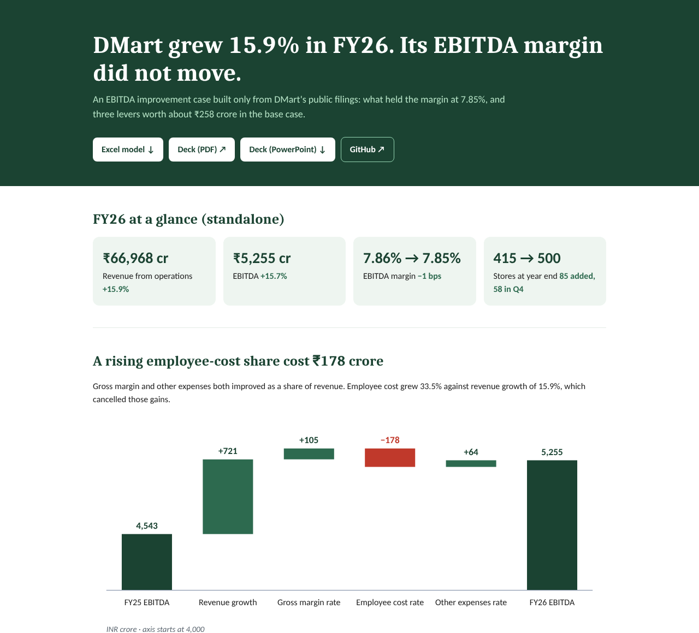

# DMart EBITDA improvement case

DMart grew revenue 15.9% in FY26, but its EBITDA margin stayed flat at 7.85%. This case explains why and sizes three improvement levers, using only DMart's public filings.

**Live summary:** https://dmart-ebitda-case.vercel.app

[](https://github.com/Shreyashsalv2/dmart-ebitda-case/actions/workflows/ci.yml)



## What's inside
| File | What it is |
|---|---|
| [`model/DMart_EBITDA_Case.xlsx`](model/DMart_EBITDA_Case.xlsx) | Excel model with live formulas: inputs as filed, P&L and margins, EBITDA bridge with a waterfall chart, operating metrics, three levers in Cautious / Base / Stretch cases, a sensitivity grid and a checks sheet |
| [`deck/DMart_EBITDA_Case.pdf`](deck/DMart_EBITDA_Case.pdf) ([.pptx](deck/DMart_EBITDA_Case.pptx)) | 10-slide deck: situation, diagnosis, hypothesis, levers, scenarios, risks and next steps |
| [`data/`](data/) | The figures as filed, with [every source](data/SOURCES.md) |
| [`site/`](site/) | The one-page summary deployed on Vercel |

## Findings (standalone, FY25 → FY26)
- Revenue rose 15.9% to ₹66,968 crore and EBITDA 15.7% to ₹5,255 crore. The EBITDA margin moved from 7.86% to 7.85%.
- Gross margin improved by 16 bps and other expenses by 10 bps of revenue. Employee cost grew 33.5%, adding 27 bps (₹178 crore at FY26 revenue), which cancelled those gains.
- DMart opened 85 stores, 58 of them in Q4. Revenue per square foot of year-end space fell 3.2%. The working hypothesis is that new stores were staffed before they reached full sales.
- In the base case, three levers (staffing new stores to a sales ramp, a small mix shift, a faster new-store ramp) add about ₹258 crore and lift the FY26 margin to 8.10% (+25 bps). The cautious case adds 3 bps, the stretch case 47 bps.

The lever sizes are the author's assumptions. They are FY26 pro-forma figures, not forecasts or DMart guidance.

## How it's built
```
data/financials.csv, operating.csv   figures as filed (INR, INR lakh) + source keys
        │
scripts/case.py        converts to INR crore and computes every number once (build/case.json)
        ├── scripts/build_model.py   Excel model; every derived cell is a formula over the Inputs sheet
        ├── deck/build_deck.js       pptxgenjs deck from case.json
        └── scripts/build_site.py    summary page + downloads
tests/test_case.py     reconciles to the filings and checks every output agrees
```
EBITDA is revenue minus cost of goods sold, employee cost and other expenses (other income excluded). Defined this way it reproduces DMart's reported ₹5,255 crore, and the model rebuilds both years' reported profit before and after tax to the paisa.

## Run it
```bash
pip install -r requirements.txt
python scripts/case.py            # prints EBITDA, the bridge and the scenarios
python scripts/build_model.py     # writes model/DMart_EBITDA_Case.xlsx (open in Excel to calculate)
npm install && npm run deck       # rebuilds the deck (optional)
python scripts/build_site.py      # rebuilds site/ and copies the downloads
```

## Tests
```bash
pytest -q
```
The 28 tests check that:
- the figures reconcile to what DMart reported (EBITDA, its growth and margin, revenue, and profit before and after tax for both years);
- the bridge adds up and the levers and sensitivity grid are internally consistent;
- the Excel model's formulas, evaluated in Python with [pycel](https://github.com/dgorissen/pycel), give the same numbers as `case.py`, every check on the Checks sheet passes, and the committed workbook matches the generator;
- the deck, the site and the downloadable files all show the current numbers.

GitHub Actions runs all of this on every push.

## Limits
- Public data only. There is no store-level, category or staffing data, so the hypothesis is untested.
- FY24 line items are not in the same machine-readable NSE format, so the case compares the two latest audited years.
- Revenue per square foot uses year-end area. DMart reports its own figure on weighted-average area.

Independent student analysis by Shreyash Singh Salv. Not investment advice; not affiliated with or reviewed by DMart.

## License
MIT
